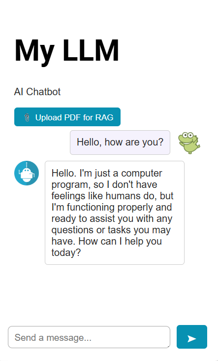

# LLM Application Chatbot

A publicly deployed AI chatbot powered by OpenAI GPT-OSS 120B via the Groq API, hosted on Netlify. Supports standard multi-turn conversation as well as **Retrieval-Augmented Generation (RAG)** — upload a PDF and the chatbot answers questions grounded in its content.

**Live app:** [https://ai-powered-chat.netlify.app/](https://ai-powered-chat.netlify.app/)

## Screenshots



## Tools and Technologies Used

- **Node.js 18** -- serverless functions (Netlify Functions, including a background function)
- **Groq API** -- LLM inference (OpenAI GPT-OSS 120B)
- **Google Gemini Embeddings** (`gemini-embedding-001`, free tier) -- semantic chunking and prompt embeddings
- **ChromaDB** -- vector database, self-hosted in Docker on Render ([chroma-server](https://github.com/Haroonkhan0629/chroma-server))
- **PDF.js** (v3.11, bundled locally) -- client-side PDF text extraction
- **Netlify** -- hosting, serverless functions, continuous deployment
- **HTML5 / CSS3 / JavaScript (ES6+)** -- frontend
- **Git and GitHub**

## Key Features

- Publicly accessible browser-based chatbot interface
- **PDF RAG pipeline** -- semantic chunking, vector storage in ChromaDB, and retrieval of only the relevant chunks per question
- PDF text is extracted in the browser (PDF.js); indexing runs in a Netlify **background function** so it never hits the 10 s timeout
- Few-shot Chain-of-Thought prompt; only the final `Answer:` is shown to the user
- Render cold-start handling: the page warms the database on load and the upload waits until it is awake
- Multi-turn conversation memory (last N exchanges sent with each request)
- API keys secured server-side, never exposed to the browser

## How It Works

### Regular Chat

`script.js` sends the user message and conversation history as a POST to `/.netlify/functions/chatbot`, which calls the Groq API and returns the AI reply.

### PDF RAG Pipeline

**Upload / indexing**

| Step | What happens |
|---|---|
| **1. Warm up** | `script.js` calls `chroma_warmup` (on page load and every 10 min). On upload it shows "Uploading..." and polls until Chroma answers its heartbeat |
| **2. Extract** | PDF.js extracts the text in the browser |
| **3. Start indexing** | The browser creates a random `docId` and POSTs `{ docId, text }` to `rag_ingest-background`, which returns 202 immediately |
| **4. Semantic chunking** | In the background, `indexDocument` splits the text into sentences, embeds each with Gemini, and starts a new chunk where the meaning shifts most (top 10% cosine distance; 200-1500 chars) |
| **5. Store** | Chunk embeddings are stored in ChromaDB with the text and `docId`. A final `docId:done` marker row signals completion (or records the error) |
| **6. Poll** | The browser polls `rag_status` every 2 s until the status is `ready` (or shows the error) |

**Asking a question**

| Step | What happens |
|---|---|
| **1. Embed** | `rag_query` embeds the prompt with Gemini |
| **2. Retrieve** | `findRelevantChunks` queries Chroma for the top 5 chunks, filtered by `docId` |
| **3. Inject** | The chunks are placed in the Groq prompt after the few-shot Chain-of-Thought system instructions |
| **4. Answer** | Groq reasons step by step; the function returns only the text after `Answer:` |

Notes: all users share one Chroma collection and are separated only by `docId`. Render's free tier sleeps after 15 minutes and has no persistent disk, so stored documents are lost on restart, which suits a quick upload-and-chat app. The Clear button resets the browser state only; it does not delete chunks from Chroma.

### Serverless Functions

| File | Route | Purpose |
|---|---|---|
| `netlify/functions/chatbot.js` | `/.netlify/functions/chatbot` | Multi-turn chat via Groq |
| `netlify/functions/rag_ingest-background.js` | `/.netlify/functions/rag_ingest-background` | Background function: chunk, embed, store a PDF |
| `netlify/functions/rag_status.js` | `/.netlify/functions/rag_status` | Reports `processing`, `ready` or `error` for a `docId` |
| `netlify/functions/rag_query/rag_query.js` | `/.netlify/functions/rag_query` | Embeds the question, retrieves chunks, calls Groq |
| `netlify/functions/chroma_warmup.js` | `/.netlify/functions/chroma_warmup` | Pings Chroma to wake it from sleep |
| `netlify/functions/rag_shared/rag.js` | (not a route) | Shared RAG functions: `embed`, `semanticChunks`, `indexDocument`, `getIndexStatus`, `findRelevantChunks` |
## Deploying to Netlify

### Prerequisites

- A [Groq API key](https://console.groq.com) (free account)
- A [Gemini API key](https://aistudio.google.com/apikey) (free) for embeddings
- A ChromaDB server, e.g. the [chroma-server](https://github.com/Haroonkhan0629/chroma-server) Dockerfile deployed on Render
- The project pushed to a GitHub repository

### 1. Get a Groq API Key

Go to [console.groq.com](https://console.groq.com) -- **API Keys** -- **Create API Key** and copy the key.

### 2. Push the Project to GitHub

```bash
git init
git add .
git commit -m "initial commit"
git remote add origin <your-github-repo-url>
git push -u origin main
```

### 3. Connect the Repo to Netlify

- Go to [app.netlify.com](https://app.netlify.com)
- Click **Add new site** -- **Import an existing project** -- **GitHub**
- Select your repository
- Leave **Build command** blank -- `netlify.toml` handles configuration
- Set **Publish directory** to `.`
- Click **Deploy site**

### 4. Add Environment Variables

In Netlify: **Site configuration** -- **Environment variables** -- **Add a variable**

| Key | Value |
|---|---|
| `GROQ_API_KEY` | Your Groq API key |
| `GEMINI_API_KEY` | Your Gemini API key |
| `CHROMA_URL` | Base URL of your Chroma server, e.g. `https://chroma-server-xxxx.onrender.com` |

Trigger a redeploy after saving: **Deploys** -- **Trigger deploy** -- **Deploy site**

### 5. Open the Live App

Your site will be live at the URL shown on the Netlify dashboard.

---

## Running Locally

Use the **Netlify CLI** to emulate the full serverless environment locally.

### Prerequisites

- Node.js 18+
- [Netlify CLI](https://docs.netlify.com/cli/get-started/): `npm install -g netlify-cli`

### Steps

```bash
git clone <your-repository-url>
cd LLM_application_chatbot
```

Create a `.env` file:

```
GROQ_API_KEY=your_groq_api_key_here
GEMINI_API_KEY=your_gemini_api_key_here
CHROMA_URL=https://your-chroma-server.onrender.com
```

Start the dev server:

```bash
netlify dev
```

The app runs at `http://localhost:8888`.

---

## API Reference

### `POST /.netlify/functions/chatbot`

```json
// Request
{ "prompt": "Your message", "history": [{ "role": "user", "content": "..." }] }

// Response
{ "response": "Model output text" }
```

### `POST /.netlify/functions/rag_ingest-background`

```json
// Request (returns 202 immediately; indexing continues in the background)
{ "docId": "uuid", "text": "full extracted text..." }
```

### `GET /.netlify/functions/rag_status?docId=<uuid>`

```json
{ "status": "processing" }  // or "ready", or { "status": "error", "error": "..." }
```

### `POST /.netlify/functions/rag_query`

```json
// Request
{ "prompt": "What does the document say about X?", "docId": "uuid" }

// Response
{ "response": "Based on the document..." }
```